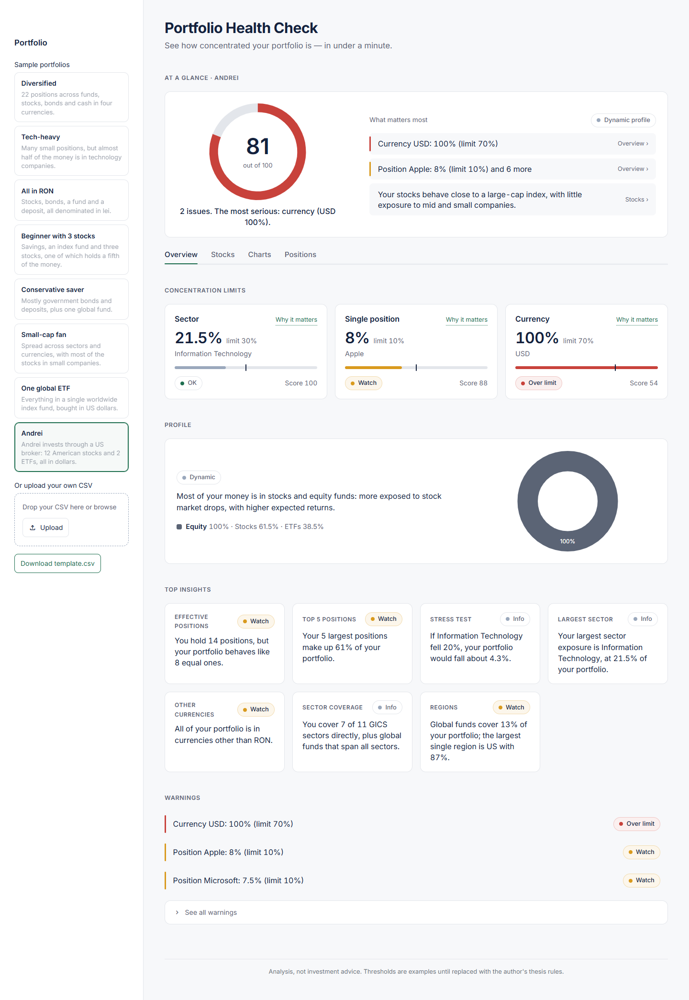
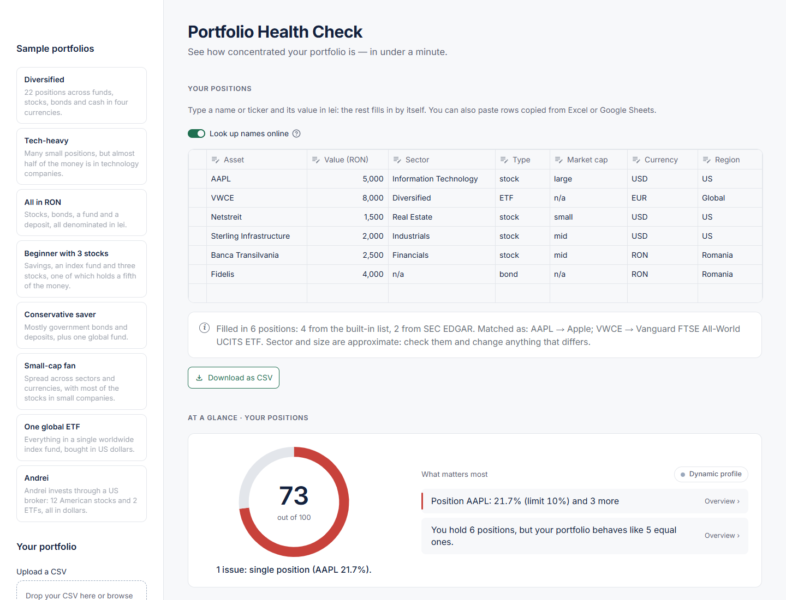

# Portfolio Health Check

Portfolio Health Check is a local web tool that shows an individual investor, in under a minute, how concentrated their portfolio is. You pick a sample portfolio, upload a CSV, or type your positions straight into the app. The app gives a score from 0 to 100, based on two concentration limits: sector and single position. It then lists what to look at first, compares every figure with its threshold, and adds plain-language insights about asset classes, market cap and regions. It is analysis, not investment advice.



## Quick start on Windows

1. Install Python 3.12 or newer from [python.org](https://www.python.org/downloads/) and tick "Add python.exe to PATH".
2. Double-click **`start.bat`**.

The first time, it sets everything up (about a minute). After that, it starts at once. The app opens in your browser at http://localhost:8501. Keep the black window open while you use the app, and close it to stop the app.

## Three ways to enter a portfolio

1. **Try a sample:** pick one of the eight sample portfolios in the side panel, or one of the ten "Stress tests" below them, each built to sit right on a threshold. "Edit these positions" turns any of them into a starting point for your own.
2. **Type or paste:** click "Type or paste positions" and enter a name or ticker and its value in lei. Sector, type, market cap, currency and region fill in by themselves (see below), and whatever cannot be found is chosen from drop-down lists. You can also paste rows copied from Excel or Google Sheets (name, then value). "Download as CSV" keeps them for next time.
3. **Upload a CSV:** the format is below. Files saved by Excel with Romanian settings work as they are, with `;` between columns and a decimal comma (1.234,56). Common spellings are accepted too ("Stock", "Large cap", "USA"). A file with only names and values is enough: the app offers to fill in the missing details.



## Where the details come from

Only free sources whose terms allow this use, in this order:

| Source | Covers | Licence | Gives |
|---|---|---|---|
| Built-in list, [data/known_securities.csv](data/known_securities.csv) | about 250 popular stocks and funds: US and European large caps, Bucharest (BVB) shares, the ETFs listed in Bucharest, the largest UCITS ETFs (global, US, European, emerging markets, bonds, a money-market fund) and US ETFs | our own compilation | everything |
| [SEC EDGAR](https://www.sec.gov/edgar) | every company listed in the US (about 10,000), including European and emerging-market companies with US listings | U.S. government data, public domain | sector (from the SIC code), size (from the public float), region (from the business address), currency |
| [OpenFIGI](https://www.openfigi.com) | listings on other exchanges, and funds | free, MIT licence, no restrictions on use or redistribution | type and currency; for funds, region and sector read from the fund's name |

- **Not used:** Yahoo Finance and the libraries that read it (such as yfinance). Yahoo's terms do not allow automated extraction.
- **Approximate sector and size:** GICS sector assignments and live market caps are licensed commercial data. The sector here comes from the official SIC code through our own table, and the size from the public float the company last reported. The app says so and lets you change both.
- **What still needs a choice:** a European share that is not in the built-in list gets its type, currency and region, but you choose its sector and size. A ticker on its own is read as the US ticker (M is Macy's, not MedLife on BVB), so type the company name for a share listed only in Europe.
- **Privacy and offline use:** only the names you type are sent. The "Look up names online" switch turns the lookup off, and the editor works offline.
- **Optional settings:** a free [OpenFIGI API key](https://www.openfigi.com/api) in the `OPENFIGI_API_KEY` environment variable raises OpenFIGI's limit on name searches. `PHC_CONTACT` adds an e-mail to the identification string SEC asks automated clients to send.

Add a row to the built-in list to teach the app a new stock or fund.

## Share it with colleagues (a link)

The app can run for free on [Streamlit Community Cloud](https://share.streamlit.io), straight from the public GitHub repository:

1. Push the project to GitHub (`git push -u origin main`).
2. Sign in at share.streamlit.io with your GitHub account.
3. **Create app** → choose the repository `portfolio-health-check`, branch `main`, main file `app.py`; under **Advanced settings** pick Python 3.12, the version the app was tested with → **Deploy**.
4. In a few minutes the app has an address such as `https://<name>.streamlit.app`: send that link.

Every visitor gets their own session: one person's portfolio is never shown to another. Streamlit Community Cloud keeps its own logs and has its own privacy policy, which applies to the online copy.

## Install and run by hand

Requires Python 3.12 or newer. `requirements.txt` pins the exact versions the app was tested with (tested on Python 3.12 and 3.15).

```bash
python -m venv .venv
.venv\Scripts\Activate.ps1        # Windows PowerShell
# source .venv/bin/activate      # macOS / Linux
pip install -r requirements.txt
streamlit run app.py
```

The app opens at http://localhost:8501. Run the tests with `pytest`.

## How to read the score

The app opens with a short "Before you start" window: the app is just math on the numbers you enter, not investment advice. It also explains the score in a few lines. "How the score works" at the bottom of the page opens it again.

**Your data.** The app keeps your portfolio only in memory while you use it: nothing is written to a file, and it is gone when you close the page. Run on your computer, nothing leaves it; in a shared online copy, the portfolio is held by the hosting service for the time you use it. With the online lookup on, only names and tickers are sent to SEC EDGAR and OpenFIGI, never values. Streamlit's usage statistics are turned off in [.streamlit/config.toml](.streamlit/config.toml).

The score (0 to 100, shown on a gauge with tiers D, C, B, A and A+) is the average of three parts, each from 0 to 100 ([decision D9](docs/decisions.md)):

- **Sector:** 100 minus a penalty for every sector above 25%.
- **Positions:** 100 minus a penalty for every single company above 10%.
- **Spread:** how many equal stocks your single companies are worth, from the HHI concentration index (10,000 / HHI). 30 or more scores 100, the number research gives for a well-diversified portfolio of randomly chosen stocks (Statman, 1987). Funds, government bonds, cash and precious metals count as spread out.

The penalty grows faster than the breach: each excess is measured in limits and squared. A company at 15% (half a limit over) costs 25 points; one at 20% (a full limit over) costs all 100. Every breach counts, not only the largest, so six companies at 15% score far lower than one. Watch and Just over are warnings and cost nothing, but while a limit is Just over the score stays below 95 (no A+), and while one is Over limit it stays below 85 (no A).

| Tier | Score |
|---|---|
| A+ | 95–100 |
| A | 85–94 |
| B | 70–84 |
| C | 50–69 |
| D | below 50 |

The weights of the three parts, the squared penalty, the caps and the tiers are our choices; the limits and the 30 stocks come from the sources below. The sector limit also has a safety margin: up to 5 points over it, the status is Just over (orange) instead of Over limit (red).

| Limit | Watch from | Limit | Just over up to | Not counted |
|---|---|---|---|---|
| Sector | 20% | 25% | 30% | broad funds (Diversified), n/a |
| Single position | 5% | 10% | – | broad ETFs, government bonds, cash, precious metals |

All thresholds live in [rules.py](rules.py). No regulator sets a limit for an individual investor, so the two limits are the ones set for funds, used here as a reference:
- **Single position, 5% and 10%:** the limits EU and US law set for diversified funds ([decision D2](docs/decisions.md)).
- **Sector, 25%:** the US regulator treats a fund with 25% or more in one industry as concentrated ([decision D3](docs/decisions.md)). The sector Watch threshold (20%) and the 5-point margin are examples.

**Funds.** A broad fund counts as diversified: it doesn't count towards the limits, so it never lowers the score. Its weight still matters: a fund of 5% barely changes a portfolio of five stocks, while a fund of 50% halves every stock's weight (see the "Five stocks" stress tests). The app can also count index funds by what they hold, from a table of index figures (`data/index_funds.csv`), but it ships without that table: the figures we had came from index providers whose terms don't allow redistribution ([decision D8](docs/decisions.md)). Public-domain figures, from the holdings US funds file with the SEC, are planned.

**Bonds and precious metals.** Government bonds and cash don't count towards the limits. A corporate bond counts towards the single-position limit, like a position in the company. Precious metals are shown in the profile and in an insight, but don't count towards the limits ([decision D7](docs/decisions.md)).

## Informative dimensions (not scored)

- **Summary:** at the top, "What looks good" (at most three points) and "What to look at", from the same facts as the score.
- **Asset mix:** stocks, ETFs, bonds, cash and precious metals, shown as they are. There is no right mix, and no label such as "Conservative": the cut-offs had no source ([decision D10](docs/decisions.md)).
- **Market cap:** the stocks' small / mid / large split, shown in the Stocks tab, without a note.
- **Currency:** the share outside RON is an insight, not a limit ([decision D1](docs/decisions.md)), with what it means in lei. Over long periods currency moves matter less for stocks than company and sector risk, and the leu never counts, since it is the investor's own currency. The currency is the one the asset is listed in, not the one the company earns in.
- **Region:** the region of the company or fund, not of the currency. It is shown as a note, not scored: the note appears when one region (Global funds excluded) holds most of the portfolio. When your largest region is the US, the Regions insight compares it with the US share of all listed companies in the world (about 49%, World Bank, 2025), with the source behind a (?) ([decisions D4, D8](docs/decisions.md)).
- **Insights:** the concentration index (HHI), on a scale of four bands (well spread below 333, i.e. 30+ equal stocks; partly spread to 1,000, i.e. 10+; concentrated to 2,500, i.e. 4+; very concentrated above), with a (?) that explains it, top 5 share, share outside RON, GICS sector coverage and regions. An insight is marked Watch when its limit or the region note needs a look; insights never change the score.

## CSV format

One row per position. Start from [data/template.csv](data/template.csv).

| Column | Values | Rules |
|---|---|---|
| asset | any name | |
| value | number > 0 | always in lei (RON) |
| sector | an official GICS sector name, `Diversified` or `n/a` | broad ETFs are `Diversified`; single-sector ETFs keep their sector; bonds, cash and precious metals are `n/a` |
| asset_type | `stock` / `ETF` / `bond` / `corporate bond` / `cash` / `precious metal` | `bond` is a government bond; ETFs are treated as equity; bond ETFs are marked `bond`; `gold` and `silver` are read as `precious metal` |
| market_cap | `large` / `mid` / `small` / `n/a` | `n/a` for everything that is not a stock; large > $10bn, mid $2–10bn, small < $2bn |
| currency | `RON`, `USD`, `EUR`, … | the currency of the asset |
| region | `US` / `Europe` / `Romania` / `Emerging` / `Global` | the region of the company or fund, not of the currency; global ETFs are `Global`; bonds and cash take the region of the issuer or bank |

The 11 official GICS sectors: Energy, Materials, Industrials, Consumer Discretionary, Consumer Staples, Health Care, Financials, Information Technology, Communication Services, Utilities, Real Estate. Common aliases are accepted and replaced by the official name, in any letter case: for example Technology → Information Technology, Healthcare → Health Care, Telecom → Communication Services (full list in [rules.py](rules.py)).

`region` is optional: without it, the analysis runs without the region part. Every other column is required.

## Known limitations

- The Watch thresholds, the sector margin and the note thresholds are EXAMPLES until they are replaced with the rules from the author's bachelor's thesis.
- A fund on a small index (BET, BET-TR, BET-TRN, BET-XT, CROBEX10) counts in the spread as its companies at equal weights, the most spread it can be; BET caps a company at 20%, so the real concentration is higher ([decision D11](docs/decisions.md)).
- ETF tickers point to the listing most investors in Romania use (Bucharest or Xetra); another listing of the same fund may trade in another currency, which you can change in the editor.
- US-domiciled ETFs (SPY, VOO, QQQ…) are in the list for portfolios that already hold them; EU retail investors usually can't buy them, because they have no PRIIPs key information document.
- Funds are not looked inside: an S&P 500 fund and a company you also hold directly are not added together.
- There is no market reference for company sizes: the figures we had came from an index provider whose terms don't allow reproducing them.
- A corporate bond and a stock of the same company are not added together, because their names differ.
- No live prices: values are entered by hand, in lei.
- The details filled in automatically are approximate: market caps change, sectors come from SIC codes (not GICS), and each fund in the built-in list has one common listing, so if you bought it in another currency, change the currency in the editor.

## Sources

- Banz, R. W. (1981). The relationship between return and market value of common stocks. *Journal of Financial Economics*, 9(1), 3–18.
- Fama, E. F., & French, K. R. (1993). Common risk factors in the returns on stocks and bonds. *Journal of Financial Economics*, 33(1), 3–56.
- Froot, K. A. (1993). Currency hedging over long horizons. NBER Working Paper 4355.
- Campbell, J. Y., Serfaty-de Medeiros, K., & Viceira, L. M. (2010). Global currency hedging. *Journal of Finance*, 65(1), 87–121.
- Directive 2009/65/EC (UCITS), Article 52: the 5/10/40 diversification rule for funds.
- Investment Company Act of 1940, section 5(b)(1): at most 5% in one issuer for a diversified US fund.
- ERISA section 407(a): at most 10% of a US pension plan in the employer's own shares.
- U.S. Securities and Exchange Commission, Guidelines for Form N-1A, Guide 19 (1983): 25% or more in one industry is concentration.
- World Bank, World Development Indicators, CM.MKT.LCAP.CD (market capitalization of listed domestic companies), 2025. Licence CC BY 4.0.
- Directive 2009/65/EC (UCITS), Articles 53 (index funds) and 54 (government bonds).
- FINRA (2022). Concentrate on Concentration Risk. Investor Insights.
- Bessembinder, H. (2018). Do stocks outperform Treasury bills? *Journal of Financial Economics*, 129(3), 440–457.
- Statman, M. (1987). How many stocks make a diversified portfolio? *Journal of Financial and Quantitative Analysis*, 22(3), 353–363.
- U.S. Securities and Exchange Commission, EDGAR company tickers, submissions and XBRL frames (public float) APIs.
- OpenFIGI, Open Symbology API (Bloomberg; FIGI under the MIT licence).

## Licence and trademarks

The code is under the [MIT licence](LICENSE). GICS®, S&P 500®, Nasdaq-100®, MSCI® and FTSE® are trademarks of their respective owners, used here only to name what they refer to; this project is not affiliated with, endorsed or sponsored by any of them. The same goes for the fund, issuer and company names in the built-in list (iShares, Vanguard, Xtrackers, SPDR, Invesco, Patria, InterCapital, Globinvest and others), which name the products a user may hold. The sectors in the built-in list are our own assignments, made from public information, not official GICS data.

## How it was built

Developed with the help of AI (Claude). The rules, product decisions and testing are mine.
