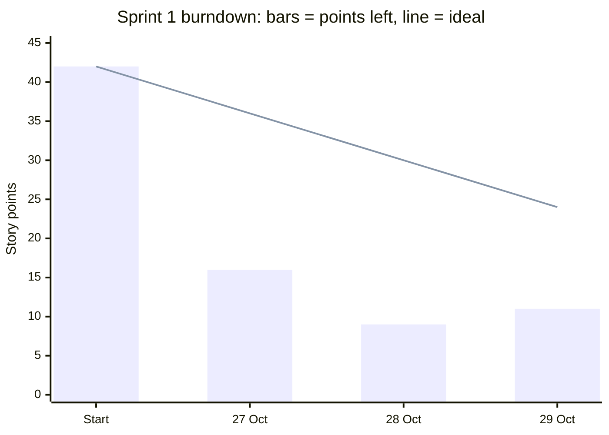

# Sprint 1 – MVP

- **Sprint Goal:** A user loads a portfolio and, in under a minute, sees their concentration score, the main risks and key insights.
- **Dates:** Tuesday 27 Oct – Monday 2 Nov 2026
- **Increment (release):** v0.1 – MVP
- Day 1 was built on my previous laptop and moved to this one on 28 Oct.
- **Jira:** Sprint 1 set up on 29 Oct, with dates 27 Oct – 2 Nov. The Jira column links each item to its card.

## Sprint Backlog

| ID | Jira | Type | Epic | Title | Points | Status | Done on |
|---|---|---|---|---|---|---|---|
| S1-01 | PHC-7 | Task | E1 | Set up the project and write the example rules | 2 | Done | 27 Oct |
| S1-02 | PHC-9 | Task | E5 | Create 8 sample portfolios and a CSV template | 2 | Done | 27 Oct |
| S1-03 | PHC-8 | Story | E2 | Load a sample portfolio or my own CSV | 3 | Done | 27 Oct |
| S1-04 | PHC-10 | Story | E4 | See my concentration score and warnings | 5 | Done | 27 Oct |
| S1-05 | PHC-11 | Story | E4 | See the essentials at a glance | 3 | Done | 27 Oct |
| S1-06 | PHC-12 | Story | E3 | Read my profile and key insights | 3 | Done | 27 Oct |
| S1-07 | PHC-13 | Story | E3 | Explore my portfolio in charts and a positions table | 2 | Done | 27 Oct |
| S1-08 | PHC-14 | Story | E6 | Compare my stocks' company sizes with the market | 3 | Done | 27 Oct |
| S1-09 | PHC-15 | Task | E5 | Automated tests and README | 3 | Done | 27 Oct |
| S1-10 | PHC-16 | Story | E2 | Type or paste positions and get the details filled in | 5 | Done | 28 Oct |
| S1-11 | PHC-17 | Story | E2 | Upload a CSV straight from Excel, even with only names and values | 2 | Done | 28 Oct |
| S1-12 | PHC-18 | Task | E5 | Polish: official GICS names, interface details, one-click start, screenshots | 3 | Done | 28 Oct |
| S1-13 | PHC-19 | Task | E4 | Replace the EXAMPLE thresholds with documented, simpler rules from my thesis | 3 | In progress | – |
| S1-14 | PHC-20 | Task | E5 | Reread and explain the code | 2 | To do | – |
| S1-15 | PHC-21 | Task | E5 | Publish the project on GitHub | 1 | To do | – |
| S1-16 | PHC-22 | Story | E4 | Don't count RON as a currency risk for someone who earns in lei | 3 | Done | 29 Oct |
| S1-18 | PHC-24 | Story | E3 | Explain "behaves like N equal positions" in plain words | 1 | Done | 29 Oct |
| S1-19 | PHC-25 | Story | E3 | Replace the stress test with simple exposure figures by sector and region | 2 | Done | 29 Oct |
| S1-20 | PHC-26 | Story | E3 | Colour each insight by what it means: good, watch, worth asking | 3 | To do | – |
| S1-21 | PHC-27 | Story | E3 | Explain "n/a" and "Diversified" in the charts | 1 | Done | 29 Oct |
| S1-22 | PHC-28 | Story | E4 | Ask a neutral question when one region holds a large share | 2 | To do | – |
| S1-23 | PHC-29 | Story | E3 | See which positions make up each bar in the charts | 3 | Done | 29 Oct |
| S1-24 | PHC-30 | Task | E4 | Review how the currency and sector limits are calculated | 3 | Done | 29 Oct |
| S1-25 | PHC-31 | Story | E3 | Keep chart labels off the limit line and make the tooltips easier to read | 2 | Done | 29 Oct |

S1-18 to S1-24 came from the Daily Scrum on 29 Oct and were pulled into the Sprint the same day. S1-24 ended in [decision D1](decisions.md): currency became a note, which also solved S1-16. S1-25 came from a look at the charts later on 29 Oct and was pulled in and done the same day. S1-13 is half done: the single-position thresholds now have sources ([decision D2](decisions.md)); the sector thresholds are still examples. Anything not Done by 2 Nov goes back to the Product Backlog.

## Product Backlog (not in this Sprint)

Added at the Daily Scrums. An item comes into a Sprint at Sprint Planning, or now if I pull it in.

| ID | Jira | Type | Epic | Title | Points | Added |
|---|---|---|---|---|---|---|
| S1-17 | PHC-23 | Story | E2 | Search bar with suggestions as you type a name or ticker | 3 | 28 Oct |

## Burndown

Story points left at the end of each day, updated at every Daily Scrum. Days 1–2 come from the Daily Scrum log. Jira's own burndown shows them on 29 Oct, the day the cards were moved to Done.

| Day | Scope | Added | Done | Points left | Ideal |
|---|---|---|---|---|---|
| Start | 42 | – | – | 42 | 42 |
| 27 Oct | 42 | – | 26 | 16 | 36 |
| 28 Oct | 45 | 3 (S1-16) | 10 | 9 | 30 |
| 29 Oct | 62 | 17 (S1-18 to S1-25) | 15 | 11 | 24 |
| 30 Oct | | | | | 18 |
| 31 Oct | | | | | 12 |
| 1 Nov | | | | | 6 |
| 2 Nov | | | | | 0 |

- **Scope:** all points in the Sprint. It grows when work is added.
- **Ideal:** the starting 42 points spread evenly over 7 days (6 a day).

## User stories and acceptance criteria

**S1-03 – Load a sample portfolio or my own CSV**
As an investor, I want to open a sample or upload my own CSV, so that I can analyse a portfolio without any setup.
- Given the start screen, when I pick "Andrei" in the side panel, then the analysis opens under "At a glance · Andrei".
- Given a CSV without the currency column, when I upload it, then a card says "Missing required column: currency" and no score is shown.
- Given the side panel, when I click "Download template.csv", then I get a file with all the columns and two example rows.

**S1-04 – See my concentration score and warnings**
As an investor, I want one score from 0 to 100 built from three limits, so that I see at once how concentrated I am.
- Given "Tech-heavy", when it opens, then the score is 75 and the Sector card shows Information Technology 45%, "Over limit".
- Given "Diversified", when it opens, then the score is 100 and the warnings read "No warnings: every limit is below its yellow threshold."
- Given "Andrei", when I open "See all warnings", then the remaining warnings appear, red ones first.

**S1-05 – See the essentials at a glance**
As an investor, I want the most important findings first, so that I understand my situation in under a minute.
- Given "Andrei", when it opens, then the ring shows 94 in yellow and the verdict reads "1 issue: single position (Apple 8%)."
- Given "Andrei", when it opens, then at most three rows appear (positions, large-cap note), each naming the tab with the details.

**S1-06 – Read my profile and key insights**
As an investor, I want my profile and plain-language insights, so that I understand what my numbers mean.
- Given "Conservative saver", when it opens, then the profile reads "Conservative".
- Given "Tech-heavy", when it opens, then an insight reads "If Information Technology fell 20%, your portfolio would fall about 9%."
- Given any portfolio, when I read the insights, then each one is marked Info or Watch.

**S1-07 – Explore my portfolio in charts and a positions table**
As an investor, I want to see my money by sector, currency, position and region, so that I spot where it is concentrated.
- Given "Tech-heavy", when I open Charts, then the bars are largest first, Information Technology is red and a dotted line marks "Limit 30%".
- Given the Charts tab, when I choose Region, then no limit line is shown.
- Given the Positions tab, when it opens, then every position shows its value in lei and its weight in %.

**S1-08 – Compare my stocks' company sizes with the market**
As an investor, I want to compare my stocks' sizes with the US market, so that I know if I lean towards small or large companies.
- Given "Small-cap fan", when I open Stocks, then a note says small caps are 73.3% of my stocks compared with the US market.
- Given "Andrei", when I click a stock in the table, then a card shows its sector, size, region and weight.
- Given "Conservative saver", when I open Stocks, then the tab says the portfolio holds no individual stocks.

**S1-10 – Type or paste positions and get the details filled in**
As an investor, I want to enter only names and values, so that I don't have to look up sectors and sizes myself.
- Given the editor, when I paste the rows "AAPL 5000" and "VWCE 8000", then sector, type, size, currency and region fill in and a note says where they came from.
- Given the editor with the online lookup on, when I type "Netstreit", then it fills in as Real Estate, small, USD, US.
- Given a row with missing details, when I look below the table, then a note lists what to complete, and the analysis appears once every row is complete.

**S1-11 – Upload a CSV straight from Excel, even with only names and values**
As an investor, I want to upload the file Excel gives me, so that I don't have to reformat it.
- Given a CSV saved by Excel with `;` and decimal commas, when I upload it, then "1.234,56" is read as 1,234.56 lei.
- Given a CSV with only names and values, when I upload it, then I can click "Fill in the missing details" and the rows open in the editor, filled in.

**S1-16 – Don't count RON as a currency risk for someone who earns in lei**
As an investor who earns in lei, I want my RON holdings not to count as a currency risk, so that the score only warns about real currency exposure.
- Given "All in RON", when it opens, then holding RON is not shown as a currency problem.
- Given "Andrei" (100% in USD), when it opens, then a note says that 100% of the portfolio is in USD (currency is a note since decision D1).

**S1-17 – Search bar with suggestions as you type a name or ticker** (after v0.1)
As an investor, I want suggestions while I type, so that I pick the right company without knowing its exact name.
- Given the editor, when I type the first letters of a company, then a list suggests matching names and tickers.
- Given the suggestions, when I pick one, then its name and details fill in.

**S1-18 – Explain "behaves like N equal positions" in plain words**
As an investor, I want this insight in plain words, so that I understand why 22 positions count as about 13.
- Given "Diversified", when I read the insight, then one simple sentence says why: a few large positions weigh more than many small ones.

**S1-19 – Replace the stress test with simple exposure figures by sector and region**
As an investor who isn't good with numbers, I want my exposure as simple percentages, so that I don't have to work out what a fall would mean.
- Given "Tech-heavy", when I read the insights, then I see "45% of your money is in Information Technology" instead of a fall scenario.
- Given a portfolio with regions, when I read the insights, then I see my largest region in %.

**S1-20 – Colour each insight by what it means: good, watch, worth asking**
As an investor, I want each insight marked by what it means, so that I see at a glance what is fine and what deserves a look.
- Given "Diversified", when I read "You cover 11 of 11 GICS sectors…", then it is marked as good.
- Given a portfolio with a red limit, when I read the related insight, then it is marked to watch.
- Each colour always comes with a word, never colour alone.

**S1-21 – Explain "n/a" and "Diversified" in the charts**
As an investor, I want to know what these labels mean, so that the charts don't confuse me.
- Given the Sector chart, when I see "Diversified" or "n/a", then a short note says: Diversified = broad funds (ETFs) spread over many sectors; n/a = bonds and cash, which have no sector.

**S1-22 – Ask a neutral question when one region holds a large share**
As an investor, I want to be asked whether a large share in one region is intentional, so that I notice it without being told what to buy.
- Given my portfolio (68% in the US), when it opens, then a neutral note asks whether that is intentional.
- Given any portfolio, the note never tells me what to buy or sell.

**S1-23 – See which positions make up each bar in the charts**
As an investor, I want to see what is inside each bar, so that I know which holdings create an exposure.
- Given my portfolio, when I click or hover the Industrials bar (28.9%), then I see the stocks in it, with their weights.
- Given the Currency or Region chart, when I do the same, then it works the same way.

**S1-25 – Keep chart labels off the limit line and make the tooltips easier to read**
As an investor, I want the charts to read cleanly, so that a value near the limit is easy to see and compare.
- Given my portfolio, when I open the Sector chart, then every value sits inside the end of its bar ("28.9%" in Industrials), never on the dotted "Limit 30%" line. A bar too short for its value shows it in the tooltip.
- Given any bar, when I hover over it, then a card shows its share first, then where it stands against the limit (for example "Close to the 30% limit"), then the positions in it, lined up.
- Given a bar near the top or bottom of the chart, when I hover over it, then the card is not cut off.

## Sprint Review (2 Nov)

- Sprint Goal met? Yes / No
- Increment delivered:
- Not Done (back to the Product Backlog):
- Demo notes:

## Sprint Retrospective (Start / Stop / Continue)

- **Start:**
- **Stop:**
- **Continue:**
